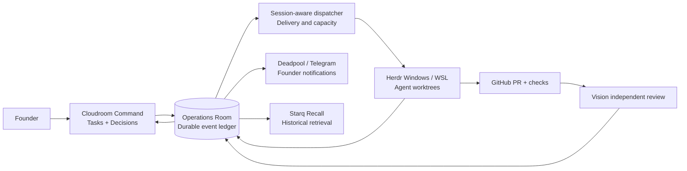

# STARQ Operations Room

**Starq-owned communications backbone for AI-assisted engineering.**

Operations Room connects **Cloudroom Command**, **Windows/WSL Herdr**, **GitHub**, **Vision**, **Starq Recall**, and **Deadpool/Telegram** through one durable instruction-and-evidence ledger. It is **internal engineering infrastructure**, not a third Starq commercial product, not a replacement Kanban, and not another coding-agent harness.

> **Source vs runtime:** This GitHub repository is the canonical version-controlled **source**. `D:\StarqTech\agent-comms` is the **running local communications system** and remains outside Git. Updating this repo does not update the live Room, Herdr watchers, or Telegram gateway by itself. The Vercel `api/` directory is a separately deployed proxy/access surface, not the complete Room backend.

## What exists, and what is proposed

| Layer | Existing implementation | This design package |
|---|---|---|
| Ledger / ingress | ROOM-PROTO-1, canonical `ACTION_REQUIRED` classification, Room JSONL / broker | Versioned typed event contract, explicit causality and evidence |
| Agents / seats | Shared identity leases, Codex/Claude/AG watchers, PR #3 universal dispatcher proposal | Exact session routing, bounded delivery, quota-aware admission |
| Coordination | Cloudroom task/thread ownership, Herdr execution, GitHub PRs, Vision verdicts | End-to-end lifecycle and Founder gate reference model |
| Reliability | Watcher checkpoints and pending delivery; PR #3 adds discovery | Ack taxonomy, retry/backoff, dead-letter/replay, recovery runbooks |
| Founder visibility | Room records and Deadpool/Telegram projections | Concise exception-oriented receipts, missed-notification reconciliation |
| Interop | CLI integrations | Optional A2A, MCP and CloudEvents edge adapters (design only) |

**Important:** `protocol/v2/*` is an **additive, dependency-free reference implementation**, not deployed code. Its tests may be run locally without live credentials; it is not yet connected to `scripts/send.mjs` or the live dispatcher. Preserve existing ROOM-PROTO-1 authority and PR #3 review; do not swap the live watcher fleet based solely on these docs.

## Architecture in one diagram



## Quick start — reference protocol only

Requires Node.js 22+.

```sh
node --test tests/room-v2-*.test.mjs
```

No network, database, token, or model subscription is needed for these pure tests. Existing repository tests and PR #3 remain independent; use each suite's documented environment.

## Documentation map

- [Starq Command convergence](docs/architecture/STARQ_COMMAND_CONVERGENCE.md) — how to integrate Cloudroom, Herdr Core, future OpenRig, provider registry, Vision, Starq Recall and Jev without making a second board
- [Config + non-destructive import](docs/configuration/PLUGGABLE_CONFIG_AND_MIGRATION.md) — preserve existing tasks, sessions, config, themes and evidence
- [Six operational message types](docs/protocol/SIX_MESSAGE_CONVERSATION.md) — Founder-friendly DISPATCH / ACK / UPDATE / BLOCKED / REVIEW / HANDOVER with machine-level receipts
- [Standards and reuse research](docs/research/STANDARDS_AND_REUSE.md) — A2A, MCP, CloudEvents, OTel and why Room remains authoritative
- [Full engineering acceptance checklist](docs/operations/ENGINEERING_ACCEPTANCE_CHECKLIST.md) — live cutover evidence, not just test claims
- [Notification eligibility and coverage](docs/operations/FOUNDER_VISIBILITY.md) — owner-aware alerts and missed Room sequence reconciliation

- [System design](docs/architecture/SYSTEM_OVERVIEW.md) — authority and boundaries
- [Cloudroom ↔ Herdr bridge](docs/architecture/CLOUDROOM_HERDR_BRIDGE.md) — exact lifecycle and adapters
- [Room v2 event schema](docs/protocol/STARQ_ROOM_V2.md) — durable events and replay
- [Routing and capacity](docs/protocol/ROUTING_AND_CAPACITY.md) — avoid waking every `@claude` / shared-AG quota collisions
- [Delivery and recovery](docs/protocol/DELIVERY_AND_REPLAY.md) — transport ACK is not work ACK
- [Task lifecycle and merge gates](docs/protocol/LIFECYCLE_AND_GATES.md)
- [Evidence and review](docs/protocol/EVIDENCE_CONTRACT.md)
- [Identity and trust](docs/protocol/IDENTITY_AND_TRUST.md)
- [Founder visibility](docs/operations/FOUNDER_VISIBILITY.md)
- [Observability](docs/operations/OBSERVABILITY_SLOS.md)
- [Live deployment runbook](docs/operations/DEPLOYMENT_AND_RECOVERY.md)
- [Chaos and acceptance tests](docs/operations/CHAOS_ACCEPTANCE.md)
- [Interoperability research](docs/integrations/INTEROPERABILITY.md)
- [Phased engineering roadmap](docs/roadmap/EXECUTION_PHASES.md)
- [PR #3 integration map](docs/reconciliation/PR3_INTEGRATION_MAP.md)
- Communication contract and seat routing (ROOM-PROTO-1) ship in PR #3 as `docs/protocol/COMMUNICATION_CONTRACT.md`; this package layers on top of it.

Additional pure references: `protocol/v2/notificationPolicy.mjs` (Founder alert eligibility + gap audit) and `protocol/v2/worktreeGate.mjs` (safe task-worktree retirement). Both are test-covered and are **not deployed**.

## Relationship to PR #3

PR #3 (`claude/ops-room-durable-foundation-20261107`) delivers the first universal discovery-driven dispatcher, canonical seat/session routing on `protocol/v1`, testability/CI and the Communication Contract. **This package is the next, separate design/reference PR**: additive `protocol/v2/*` typed contracts, lifecycle/evidence/notification/admission references, architecture and operations documentation, and pure tests. It does not modify PR #3's branch, the live Room, or the running watcher fleet. See [PR #3 integration map](docs/reconciliation/PR3_INTEGRATION_MAP.md) for the capability-by-capability reconciliation and the concrete dispatcher hardening items to pursue after PR #3 lands.

## Invariants

1. Room is the authoritative **message/evidence ledger**. Cloudroom owns task status; GitHub owns code/PR state. A Room receipt must never falsely impersonate either.
2. Agent handles can have multiple live seats. Only the addressed **session** wakes; ambiguity is reported, not guessed.
3. Every substantive assignment, ACK, blocker, correction, PR delivery, reviewer verdict, and authorized merge has a stable Room record and causal linkage.
4. No false success from a pane idle/done indicator, a Git push, a passing test, an ACK, or an intentionally-red informational CI job.
5. The Founder controls product decisions and merge approvals, while routine engineering decisions do not generate extra approval loops.
6. Source repo stays on `main`; engineering uses task-isolated external worktrees, retired only after Command closure.
7. Runtime identity registry, Room history, credentials, checkpoints and private logs never enter Git.

## Vercel proxy surface

The Vercel `api/` directory is a **secure proxy surface** and requires an authenticated upstream configured through environment variables. It is not the complete Room backend, and the repository contains no live Room data, identities, inboxes, cursors, logs, or credentials.

Set these environment variables in the private Vercel project:

- `OPS_ROOM_UPSTREAM_URL`: HTTPS URL of the authenticated Room API.
- `OPS_ROOM_UPSTREAM_TOKEN`: upstream bearer token.

The proxy returns `503` until both values are configured. Never commit either value.

### Local development

```text
npm install
npm run dev
```

This scaffold is deliberately not connected to the local `agent-comms` files. Connect a separately authenticated upstream before sharing the Vercel URL.

**Ownership:** Developed as an internal communications architecture for Starq Technologies Pvt Ltd. Existing external tools (Cloudroom, Herdr, GitHub, Hermes, MCP, A2A, etc.) remain independently owned by their respective maintainers. No assertion is made that those tools were developed by Starq.
