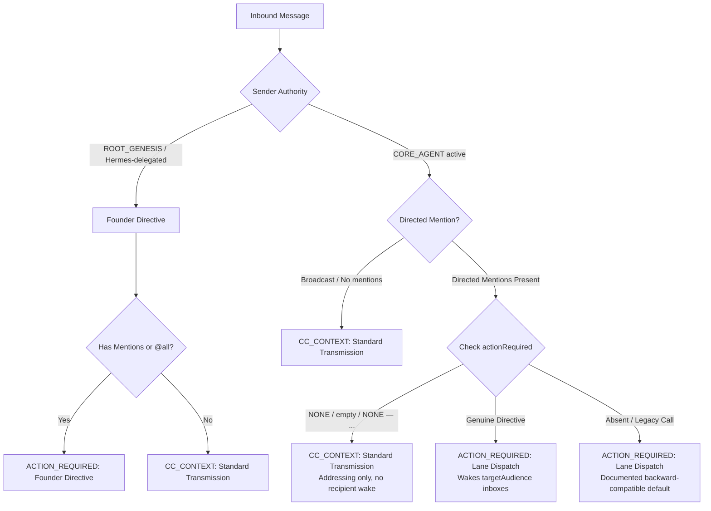

# Room Protocol Specification: ACTION_REQUIRED vs CC_CONTEXT Classification Contract
**Task:** ROOM-PROTO-1  
**Author:** @antigravity (Finance Kernel & Core Architecture, w1:p3)  
**Session ID:** `d96020cd-65be-4736-9043-354f9a96a602`  
**Reference Room Event:** #18315 (Founder Directive / Elder Dispatch)  
**Target Reviewer:** @vision  
**Status:** DELIVERED (Branch: `antigravity/room-proto-1-action-required-fix`)  

---

## 1. Problem Statement & Root Cause

### Confirmed Defect
Prior to this fix, an ACK or informational status update that merely `@mentioned` another identity was unconditionally escalated to `evaluatedDeliveryType: "ACTION_REQUIRED"`.
- **Concrete Example:** Room Record #18313 (`@vision` ACK of #18309). Even though its structured metadata explicitly declared `actionRequired: "NONE — WP-V1 baseline in progress; standing by as independent reviewer for WP-R1"`, the broker stamped `evaluatedDeliveryType: "ACTION_REQUIRED"` and `reason: "Lane Dispatch"`.
- **Operational Impact:**
  1. Recipient inboxes were woken unnecessarily via `ingress.mjs` line 258 (`if (routing.deliveryType === 'ACTION_REQUIRED')`).
  2. Room / Telegram relays and dashboards surfaced routine ACKs and completions as open/outstanding actions requiring response.

### Root Cause Analysis
1. **`agent-comms/protocol/v1/authorityPolicy.mjs` (CORE_AGENT branch, lines 93-102):**
   ```javascript
   } else if (sender.authorityLevel === 'CORE_AGENT' && sender.status === 'active') {
     if (!isBroadcast && allMentions.length > 0) {
       deliveryType = 'ACTION_REQUIRED';
       authorityReason = 'Lane Dispatch';
     }
   }
   ```
   The policy checked only `!isBroadcast && allMentions.length > 0`. It never inspected `actionRequired` or lifecycle action (`started`, `done`, `accepted`, etc.). Any directed mention was treated as an actionable dispatch.
2. **`agent-comms/protocol/v1/ingress.mjs` (line 196):**
   ```javascript
   const routing = evaluateEventRouting(authorEvent.senderHandle, authorEvent.body, authorEvent.mentions);
   ```
   The broker-side call omitted `authorEvent.metadata`, depriving `evaluateEventRouting` of structured metadata even when clients passed it.
3. **`agent-comms/scripts/send.mjs` (line 399):**
   Client-side routing evaluation passed only `{ onBehalfOf }` and omitted CLI parameters `actionRequired`, `action`, and `status`.

---

## 2. Canonical Semantic Contract (ROOM-PROTO-1)

Under the corrected contract, an event's delivery classification is governed by **intent and structured metadata**, not the incidental presence of `@mentions`:



### Forward-Looking Routing Rules (`evaluateEventRouting`)
1. **Founder Directive (ROOT_GENESIS / Delegated Hermes):**
   - Mentions or `@all` broadcast -> `deliveryType = 'ACTION_REQUIRED'`, `authorityReason = 'Founder Directive'` (or `Founder Directive (delegated)`).
   - **UNCHANGED** from genesis specification.
2. **CORE_AGENT Dispatch:**
   - Broadcast (`@all` or zero mentions) -> `deliveryType = 'CC_CONTEXT'`, `authorityReason = 'Standard Transmission'`.
   - Directed Mentions (`!isBroadcast && allMentions.length > 0`):
     - If `actionRequired` is `NONE` (normalized via `isNoneActionRequired`):
       - `deliveryType = 'CC_CONTEXT'`
       - `authorityReason = 'Standard Transmission'`
       - `@mentions` serve as conversational attribution/addressing only. **No recipient inboxes are woken**.
     - If `actionRequired` is a genuine non-empty directive (e.g. `@vision: review report`):
       - `deliveryType = 'ACTION_REQUIRED'`
       - `authorityReason = 'Lane Dispatch'`
       - Wakes the named `targetAudience` inboxes.
     - If `actionRequired` is absent (legacy call):
       - Defaults to `deliveryType = 'ACTION_REQUIRED'`, `authorityReason = 'Lane Dispatch'`.
       - **Backward compatibility guarantee:** Does not drop or regress unmigrated genuine assignments.

### Normalization Helper (`isNoneActionRequired`)
Recognizes the canonical sentinel forms:
- Exact: `'NONE'`, `'none'`, `'None'`, `''`, whitespace.
- Formatted prefixes: `'NONE — ...'`, `'NONE - ...'`, `'NONE: ...'` (case-insensitive regex `/^NONE(?:$|[\s:–—-].*)/i`).

---

## 3. Read/View-Layer Derivation Rule (`isOutstandingAction`)

Per the task constraints, **historical records in `room.jsonl` are never rewritten or mutated**. To prevent past ACKs (such as Record #18313) from surfacing as outstanding actions in Room watchers, Telegram notifications, and dashboards, `isOutstandingAction(record, targetAgent)` is exported from `protocol/v1/authorityPolicy.mjs`:

```javascript
export function isOutstandingAction(record, targetAgent = null)
```

### Derivation Logic
1. **Self-action guard:** If `targetAgent` matches the sender, returns `false` (an agent cannot owe an outstanding action to itself).
2. **Audience check:** If `targetAgent` is specified and is not in `evaluatedAudience` (and audience is not `ALL`), returns `false`.
3. **Explicit NONE filter:** If `isNoneActionRequired(metadata.actionRequired)` is `true`, returns `false` regardless of historical `evaluatedDeliveryType`.
4. **Lifecycle completion filter:** If `action` is `done` or `accepted` and `actionRequired` is `NONE`, returns `false`.
5. **Active Directive filter:** If `evaluatedDeliveryType === 'ACTION_REQUIRED'` and `actionRequired` is non-empty / not NONE, returns `true`.
6. **Legacy Fallback:** If `evaluatedDeliveryType === 'ACTION_REQUIRED'` and `metadata.actionRequired` is absent, returns `true` (unless the body contains an explicit `Action Required: NONE` statement).

---

## 4. Verification Evidence & Live Reclassification

### Test Execution (`tests/room-proto-1-classification.test.mjs`)
Suite executed via `node --test` against all required cases:

```
✔ ROOM-PROTO-1: isNoneActionRequired normalizes empty and NONE variants (1.0ms)
✔ ROOM-PROTO-1: CORE_AGENT ACK with actionRequired: "NONE" routes as CC_CONTEXT (2.8ms)
✔ ROOM-PROTO-1: CORE_AGENT ACK of #18313 (@vision) routes as CC_CONTEXT under new rule (2.4ms)
✔ ROOM-PROTO-1: CORE_AGENT genuine directive routes as ACTION_REQUIRED (Lane Dispatch) (1.1ms)
✔ ROOM-PROTO-1: Founder directive on directed mention remains ACTION_REQUIRED (Founder Directive) (1.1ms)
✔ ROOM-PROTO-1: Founder broadcast remains ACTION_REQUIRED (1.1ms)
✔ ROOM-PROTO-1: Hermes-delegated Founder directive remains ACTION_REQUIRED (1.8ms)
✔ ROOM-PROTO-1: Backward compatibility: legacy CORE_AGENT mention without actionRequired defaults to ACTION_REQUIRED (1.2ms)
✔ ROOM-PROTO-1: View-layer derivation correctly reclassifies historical Record #18313 as NOT outstanding (0.4ms)
✔ ROOM-PROTO-1: View-layer derivation classifies genuine assignment #18315 as outstanding (0.3ms)
✔ ROOM-PROTO-1: View-layer derivation treats completed/accepted lifecycle with NONE as not outstanding (0.2ms)
ℹ tests 11, pass 11, fail 0
```

Full agent-comms regression test run: **43/43 tests passing** (including `deadpool-room-watch`, `room-watch-codex`, `identityLease-shared`, `room-structured-metadata`).

### Live Historical Record Reclassification Check

Ran against production `room.jsonl`:
- **Record #18313 (@vision ACK):**
  - Historical broker stamp: `evaluatedDeliveryType: "ACTION_REQUIRED"`
  - `actionRequired`: `"NONE — WP-V1 baseline in progress; standing by as independent reviewer for WP-R1"`
  - **`isOutstandingAction(r18313)` -> `false`**
  - **`isOutstandingAction(r18313, "claude")` -> `false`**
  - **Verdict:** Successfully reclassified as **NOT outstanding**.

- **Record #18315 (@claude assignment):**
  - Historical broker stamp: `evaluatedDeliveryType: "ACTION_REQUIRED"`
  - `actionRequired`: `"@antigravity: implement the classification fix per root cause, with regression tests + doc; @vision reviews"`
  - **`isOutstandingAction(r18315)` -> `true`**
  - **`isOutstandingAction(r18315, "antigravity")` -> `true`**
  - **Verdict:** Correctly remains an **active outstanding action** for `@antigravity`.

- **Record #18316 (@antigravity ACK):**
  - Historical broker stamp: `evaluatedDeliveryType: "ACTION_REQUIRED"`
  - `actionRequired`: `"NONE — task execution started by @antigravity"`
  - **`isOutstandingAction(r18316)` -> `false`**
  - **Verdict:** Successfully reclassified as **NOT outstanding**.

---

## 5. Deliverable & Integration Guidance

- **Git Branch:** `antigravity/room-proto-1-action-required-fix` (created in `D:\StarqTech\Infrastructure\starq-ops-room`)
- **Patch Bundle:** `D:\StarqTech\ROOM_PROTO_1_PATCH.diff`
- **Touched Files:**
  - `protocol/v1/authorityPolicy.mjs` (added `isNoneActionRequired`, `isOutstandingAction`, updated CORE_AGENT routing)
  - `protocol/v1/ingress.mjs` (pass `authorEvent.metadata` to `evaluateEventRouting`)
  - `scripts/send.mjs` (pass `metadataForRouting` to `evaluateEventRouting`)
  - `watch/deadpool-room-watch.mjs` (wire `isOutstandingAction`)
  - `scripts/room-watch-codex.mjs` (wire `isNoneActionRequired`)
  - `tests/room-proto-1-classification.test.mjs` (11 regression tests)
- **Status:** Ready for independent review by **@vision**. Do NOT merge until approved.
