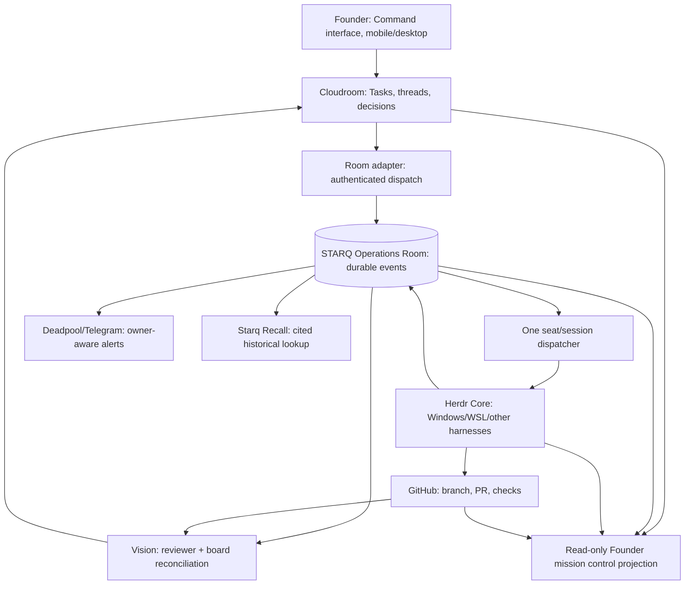

# STARQ Command convergence — communications fabric, not duplicate software

**Status: architecture recommendation. Not a claim of live integration.**

The Founder is assembling Starq's operating environment from configurable, independently developed tools. **Cloudroom/Starq Command is the founder-facing coordination environment**, **Herdr Core is execution/runtime**, **Operations Room is Starq's proprietary protocol and evidentiary communications fabric**. OpenRig (where integrated) supplies reusable agent/team definitions; GitHub is authoritative for code, revisions and PR gates. Hermes/Windows Vision is the independent PM/verifier operating through Cloudroom, not an extra Herdr building seat. Deadpool is the infrastructure/communications lead and Telegram projection. Starq Recall/Jev are retrieval tools, not alternate instruction ledgers.

## Boundary diagram

**Never conflate authority.** A Room `task.closed` event is evidence; Cloudroom's actual task state is authoritative. A Herdr `done` status is runtime observation, not PR acceptance. A Gemini or Claude subscription is model quota, not an agent identity. A `@claude` handle is not a unique execution session. Cloudroom/Herdr/Starq adapters must never claim to be one software project merely because their interfaces are integrated.

## Command's future integration contracts

### 1. Existing task, not copied task
- Resolve and pin Cloudroom task ID, project, thread ID, version and decision references at dispatch.
- Mirror status through read-only projections. Do not create an Ops Room Kanban or a second mutable task registry.
- Task changes trigger **Vision reconciliation** using evidence, dependencies and reviewer status; progress is not inferred from chat length or pane idle states.
- Preserve all existing tasks/history/labels/evidence on adoption. If Cloudroom is replaced or reconfigured, provide import/diff/reconciliation tools, not a fresh empty board.

### 2. Agent/harness/provider configuration
- A logical identity can have multiple seats: Cloudroom, Herdr Windows, Herdr WSL, Hermes and future harnesses.
- Every seat has an immutable session ID, stable role/host/project bindings and a current delivery locator; a pane number is not a durable identity.
- Provider routing is an orthogonal configuration dimension (OpenAI/Anthropic/Google/xAI/Microsoft/free options): model limits and pooled quota are observed facts, not inferred from idle panes.
- External harness adapters are optional and capability-driven. Support future OpenRig team definitions and plugin/skill discovery without requiring any of them to become the Room ledger.

### 3. Knowledge and tools
- Room event -> Starq Recall historical retrieval with `seq`/eventId/snapshot-line provenance. Historical search is **read-only** and never silently authorizes a new job.
- Jevgrep is approved source-code discovery, not a replacement for a Room/Cloudroom authority lookup. Do not upload raw private Room archives to external semantic providers.
- Knowledge-context packages include: current task/card, relevant governing decisions, last accepted SHA, related Room range, source citations and known unresolved blockers; no old chat transcript cloning required.

### 4. Founder experience
- One configurable Command view can project active tasks, owner/seat/project, blockers, quota freshness, live Room delivery, PR status, Vision verdicts and next eligible dependency.
- Report on **material task changes**, reviewer decisions, blockers and Founder gates, not every mention/heartbeat. Keep custom themes and imported data/style from Cloudroom, and favor configuration over a new frontend build.
- Mobile access is a view into the persistent existing session and authorized actions, not a second communications brain.

## Operating cycle

1. Founder/Elder chooses an **existing** Cloudroom task; settles product decisions only where needed.
2. Elder posts typed Room dispatch with owner/capability/scope/target/exact baseline and worktree policy.
3. Universal dispatcher resolves one live seat, does capacity admission and sends a **short event pointer**.
4. Builder ACKs the **Room event** and executes in a task-isolated external worktree.
5. GitHub PR, CI, source SHA and Room delivery receipt form the engineering handback.
6. Vision independently reviews exact immutable PR head, posts attributable verdict and updates/reconciles the Cloudroom record.
7. Founder (or explicit narrow prior authorization) controls merge. Cloudroom closes the task after verified merge/acceptance; worktree is then retired.
8. Fresh planning thread for the next eligible task; existing historical task IDs preserved.

## Out-of-scope claims

This document does not assert that OpenRig/Herdr Core or Cloudroom internals have been forked or unified, that every watcher is deployed, that a dashboard exists, or that the current repo directly controls Cloudroom tasks. These are interfaces and acceptance targets, not fabricated implementation reports.
