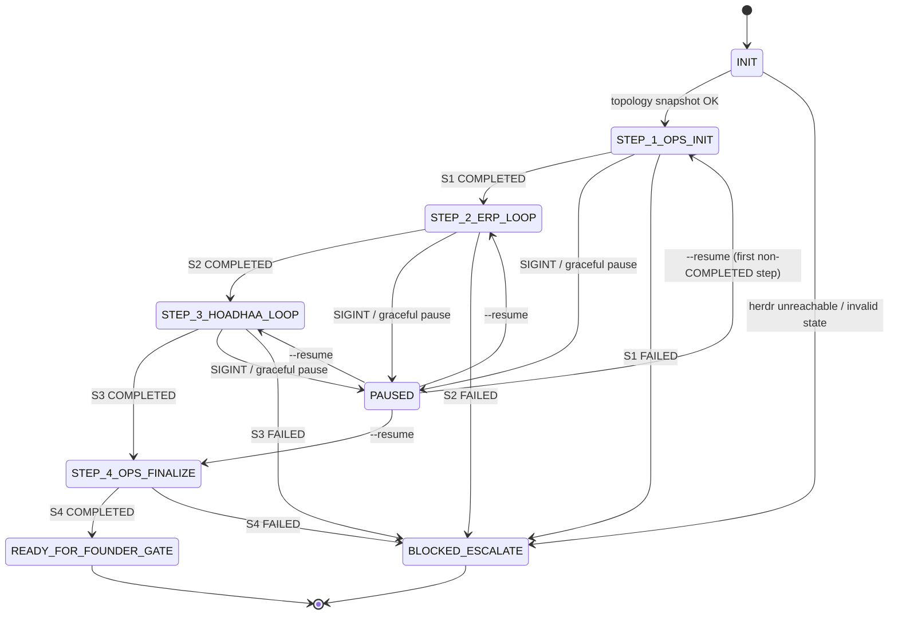
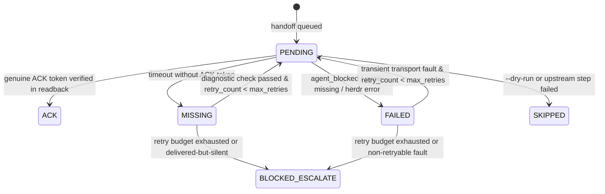

# Starq Ops Room — Hardened Startup Handshake Protocol (v1 DESIGN)

**Status:** DESIGN PHASE ONLY (pending Ops Room Vision + Founder approval before BUILD+TEST).  
**Author:** Ops AG (`w3:p2`)  
**Date:** 2026-11-21  
**Brief:** `docs/operations/_briefs/AG-BRIEF-STARTUP-HANDSHAKE-DESIGN-2026-11-21.md`  
**Integrates with:** `docs/operations/OPS-ROOM-OPERATING-PROCEDURE-v1-DRAFT.md`  

---

## 1. Overview

This document specifies a durable, repeatable, idempotent startup-handshake protocol that verifies daily operational readiness across Command, Ops Room, StarqERP, and Hoadhaa (including the remote XPS machine) before any engineering execution begins. It operationalizes the communication paths and delivery discipline defined in [OPS-ROOM-OPERATING-PROCEDURE-v1-DRAFT.md](file:///D:/StarqTech/starq-ops-room/docs/operations/OPS-ROOM-OPERATING-PROCEDURE-v1-DRAFT.md) without duplicating or modifying that SOP, `watch/`, `protocol/`, `api/`, or the Cloudroom thread registry. A deterministic Node.js orchestrator (`scripts/startup-protocol/`) drives all Herdr handoffs over `herdr` CLI (`local` and `--machine XPS`), persists per-run state and an append-only ACK ledger under `runs/startup/<run_id>/`, enforces pane-readback ACK verification and bounded diagnostic retries, and delivers only a consolidated readiness summary to Vision seats so Vision LLM consumption stays minimal. Step 5 (execution gate) remains strictly Founder-only and is never triggered by this protocol.

---

## 2. Topology

### 2.1 Live-Verified Seats & Pane IDs

Verified on 2026-11-21 via `herdr pane list` (Nitro local) and `herdr --machine XPS pane list` (XPS remote):

| Seat | Machine | Pane / Thread ID | Harness / Label | Working Directory | Role in Handshake |
|---|---|---|---|---|---|
| **Command Vision** | Cloudroom | `thr_7gyyc4dv22` | Cloudroom thread | N/A | Portfolio PM; initiates/receives final readiness via Ops Room Vision (`w3:p1`) |
| **Ops Room Vision** | Nitro (local) | `w3:p1` | `hermes` (`claude` session) / `claude - Operations Deputy (comms and SOP)` | `D:\StarqTech\starq-ops-room` | Step 1 init; Step 4 finalization & consolidated report to Command |
| **Ops Room AG** | Nitro (local) | `w3:p2` | `agy` | `D:\StarqTech\starq-ops-room` | Executes orchestrator & Step 4 reconciliation |
| **ERP Vision** | Nitro (local) | `w4:p1` | `hermes` / `vision - StarqERP PM / Orchestrator` | `D:\StarqTech\Projects\StarqERP` | Step 2 StarqERP studio seat |
| **PICARD** | Nitro (local) | `w4:p2` | `hermes` / `PICARD - Principal Engineering Studio` | `D:\StarqTech\Projects\StarqERP` | Step 2 StarqERP engineering studio |
| **Hoadhaa Vision** | Nitro (local) | `w2:p8` | `hermes` / `vision - Hoadhaa PM` | `D:\StarqTech\Projects\Hoadhaa` | Step 3 Hoadhaa studio seat (also reachable via Cloudroom `thr_r23tqt7wgn`) |
| **DEADPOOL** | XPS (`--machine XPS`) | `w2:p1` | `hermes` / `DEADPOOL` | `/home/mustarq` | Step 3 XPS commander |
| **JARVIS** | XPS (`--machine XPS`) | `w2:p2` | `hermes` / `JARVIS` | `/home/mustarq/Work/jarvis` | Step 3 XPS engineering seat (separate ACK required) |
| **XPS AG** | XPS (`--machine XPS`) | `w2:p3` | `agy` / `AG` | `/home/mustarq/Work` | Step 3 XPS engineering seat (separate ACK required; distinct from `w3:p2`) |

### 2.2 Logical Command Sequence (Steps 1–5)

1. **Step 1 (`S1`) — Command + Ops Room Init:** Verify `w3:p1` (Ops Room Vision) and `w3:p2` (Ops Room AG) are live. Ops Room finalization is deferred to Step 4.
2. **Step 2 (`S2`) — StarqERP Loop:** Verify `w4:p1` (ERP Vision) and `w4:p2` (PICARD), and confirm StarqERP loop readiness.
3. **Step 3 (`S3`) — Hoadhaa Loop:** Verify `w2:p8` (Hoadhaa Vision), `XPS w2:p1` (DEADPOOL), and obtain **separate** ACKs from `XPS w2:p2` (JARVIS) and `XPS w2:p3` (XPS AG); consolidate Hoadhaa loop readiness.
4. **Step 4 (`S4`) — Ops Room Finalization:** Reconcile run results + `topology_snapshot.json` against prior run / SOP; update repo + SOP **only** if real config/workflow changes are detected; deliver consolidated readiness to `w3:p1` (Ops Room Vision) to report to Command Vision (`thr_7gyyc4dv22`).
5. **Step 5 (`S5`) — Execution Gate:** Founder-only. Out of scope; script halts at `READY_FOR_FOUNDER_GATE`.

### 2.3 ACK Token Convention

Every handoff requiring an ACK uses a deterministic token derived from `handoff_id`:

```text
ACK::<run_id>::<step>::<seat_tag>::<nonce>
```

- `<run_id>`: e.g. `2026-11-21T1700Z-a1b2`
- `<step>`: `S1` | `S2` | `S3` | `S4`
- `<seat_tag>`: `OPS_VISION` | `OPS_AG` | `ERP_VISION` | `PICARD` | `HOADHAA_VISION` | `DEADPOOL` | `JARVIS` | `XPS_AG`
- `<nonce>`: first 4 lowercase hex chars of `SHA-256(handoff_id)` (deterministic across retries so a late reply from attempt 1 is still valid and unambiguous).

---

## 3. File Layout

All new code and runtime artifacts live strictly in the designated directories:

```text
D:\StarqTech\starq-ops-room\
├── docs\
│   └── operations\
│       ├── OPS-ROOM-OPERATING-PROCEDURE-v1-DRAFT.md   # Existing SOP (read-only unless real change detected)
│       └── STARTUP-HANDSHAKE-PROTOCOL-v1-DESIGN.md    # This design document
├── scripts\
│   └── startup-protocol\
│       ├── run-handshake.mjs      # CLI entrypoint (--run-id, --resume, --dry-run, --step)
│       ├── topology.mjs           # Authoritative seat/pane/machine map and step DAG
│       ├── herdr-client.mjs       # Wrapper for `herdr` / `herdr --machine XPS` CLI calls
│       ├── state-store.mjs        # Atomic state.json + append-only ledger.jsonl persistence
│       ├── ack-parser.mjs         # Baseline diffing + strict ACK token verification
│       └── reconcile.mjs          # Step 4 diffing against prior run & SOP
└── runs\
    └── startup\
        └── <run_id>\
            ├── state.json                 # Current run, step, and handoff state
            ├── ledger.jsonl               # Append-only handoff audit ledger
            ├── topology_snapshot.json     # `herdr pane list` snapshot for Step 4 diffing
            └── logs\
                ├── run.log                # Structured orchestrator log
                └── readbacks\
                    └── <handoff_id_safe>.txt  # Captured pane readback evidence per handoff
```

*(Existing `watch/`, `protocol/`, `api/`, `scripts/send.mjs`, and `scripts/room-watch-*.mjs` remain untouched.)*

---

## 4. State Machine

### 4.1 Run-Level State Machine



### 4.2 Handoff-Level State Machine



---

## 5. State Schema (`state.json`) & Ledger Schema (`ledger.jsonl`)

### 5.1 `state.json`

Written atomically (write to `state.json.tmp`, `fsync`, rename) after every state transition.

```json
{
  "schema_version": "1.0",
  "run_id": "2026-11-21T1700Z-a1b2",
  "mode": "live",
  "status": "STEP_2_ERP_LOOP",
  "current_step": "S2",
  "created_at": "2026-11-21T17:00:00.000Z",
  "updated_at": "2026-11-21T17:01:12.000Z",
  "completed_at": null,
  "steps": {
    "S1": {
      "status": "COMPLETED",
      "started_at": "2026-11-21T17:00:01.000Z",
      "completed_at": "2026-11-21T17:00:18.000Z",
      "handoffs": {
        "2026-11-21T1700Z-a1b2:S1:w3:p1->w3:p2:request": {
          "status": "ACK",
          "retry_count": 0,
          "expected_token": "ACK::2026-11-21T1700Z-a1b2::S1::OPS_AG::4e9a",
          "acked_at": "2026-11-21T17:00:17.000Z"
        }
      }
    }
  },
  "summary": {
    "total_handoffs": 8,
    "acked": 2,
    "missing": 0,
    "failed": 0,
    "skipped": 0,
    "changes_detected": null
  },
  "escalation": null
}
```

| Field | Type | Description |
|---|---|---|
| `schema_version` | `string` | `"1.0"` |
| `run_id` | `string` | Unique run identifier (`<ISO-compact>-<4hex>`) |
| `mode` | `"live" \| "dry_run"` | Execution mode |
| `status` | `enum` | `INIT`, `STEP_1_OPS_INIT`, `STEP_2_ERP_LOOP`, `STEP_3_HOADHAA_LOOP`, `STEP_4_OPS_FINALIZE`, `PAUSED`, `READY_FOR_FOUNDER_GATE`, `BLOCKED_ESCALATE` |
| `current_step` | `"S1" \| "S2" \| "S3" \| "S4" \| null` | Active or next step to execute |
| `created_at`, `updated_at`, `completed_at` | `string \| null` | ISO-8601 UTC timestamps |
| `steps` | `object` | Map of `S1`..`S4` -> `{ status, started_at, completed_at, handoffs }` |
| `summary` | `object` | Aggregate counts + `changes_detected` (`boolean \| null`) |
| `escalation` | `object \| null` | `{ handoff_id, reason, diagnostic, escalated_to, at }` when `BLOCKED_ESCALATE` |

### 5.2 `ledger.jsonl`

Append-only JSON Lines; one line appended per handoff transition (`PENDING`, `ACK`, `MISSING`, `FAILED`, `SKIPPED`).

| Field | Type | Description |
|---|---|---|
| `handoff_id` | `string` | Deterministic ID: `<run_id>:<step>:<from_pane>-><to_pane>:<direction>` |
| `run_id` | `string` | Parent run ID |
| `step` | `"S1" \| "S2" \| "S3" \| "S4"` | Protocol step |
| `from_pane` | `string` | Logical sender (e.g. `w3:p1`, `w2:p8`, `XPS:w2:p1`) |
| `to_pane` | `string` | Target pane (e.g. `w4:p1`, `XPS:w2:p2`) |
| `direction` | `"request" \| "response"` | Direction of the handoff |
| `sent_at` | `string \| null` | ISO-8601 UTC timestamp when `herdr agent prompt` was invoked |
| `acked_at` | `string \| null` | ISO-8601 UTC timestamp when ACK token was verified in readback |
| `status` | `"PENDING" \| "ACK" \| "FAILED" \| "MISSING" \| "SKIPPED"` | Handoff status |
| `evidence` | `string` | Exact pane readback snippet (or error output) proving status |
| `retry_count` | `number` | Number of retries attempted (`0` on initial attempt) |
| `notes` | `string` | Diagnostic context (e.g. `agent_status`, baseline anchor, or skip reason) |

---

## 6. Handoff Algorithm

Each handoff `(from_pane -> to_pane)` executes the following deterministic sequence:

1. **Idempotency guard:** Check `state.json` and `ledger.jsonl` for `handoff_id`. If status is already `ACK`, log `SKIP_ALREADY_ACKED` and return immediately without prompting.
2. **Pre-flight pane check:** Run `herdr [--machine XPS] pane list`. Verify `to_pane` exists. If `to_pane` is absent, append `FAILED` (`pane_not_found`) and return. If `agent_status === "blocked"`, do **not** send a prompt; append `FAILED` (`agent_blocked`) and return.
3. **Baseline readback capture:** Run `herdr [--machine XPS] agent read <pane> --source recent-unwrapped --lines 120`. Record the last 10 non-empty lines as the baseline anchor so stale tokens from earlier runs cannot match.
4. **Record `PENDING`:** Append a `PENDING` row to `ledger.jsonl` and update `state.json`.
5. **Dispatch prompt:** Invoke `herdr [--machine XPS] agent prompt <pane> "<prompt>" --wait --timeout <ms>`.
   - Note from `herdr agent prompt --help`: `--wait` returns `agent_blocked`, `agent_prompt_stalled` (if no `working`/`blocked` transition within 5000ms from idle), `timeout`, or exits 0 on `idle`/`done`/`blocked`. Because `--wait` does not track turns if the agent was already `working`, exit 0 alone is **never** treated as completion.
6. **Poll readback & classify:**
   - Capture `herdr [--machine XPS] agent read <pane> --source recent-unwrapped --lines 200`, slice strictly **after** the baseline anchor, and run the ACK parser (§7).
   - If valid ACK token found -> save full snippet to `logs/readbacks/`, append `ACK` row to `ledger.jsonl`, update `state.json`, return `ACK`.
   - If `--wait` exited 0 early (already-working turn) and deadline has not expired -> poll `agent read` every `poll_interval_ms` until ACK token appears or timeout expires.
   - On timeout without ACK -> classify `MISSING`.
   - On `agent_blocked`, `agent_prompt_stalled`, non-zero SSH/herdr error, or explicit error line -> classify `FAILED`.
7. **Retry or escalate:** If `MISSING` or `FAILED`, run the diagnostic check (§8.2). Retry only if diagnostic proves non-delivery/transient fault and `retry_count < max_retries`; otherwise transition run to `BLOCKED_ESCALATE`.

---

## 7. ACK Verification Rule

A handoff is classified `ACK` **only** if all of the following hold:

1. **Post-baseline locality:** The token appears in `herdr agent read <pane> --source recent-unwrapped --lines 200` strictly **after** the pre-send baseline anchor lines.
2. **Exact standalone token match:** A line (trimmed of leading/trailing whitespace) matches:
   ```regex
   ^ACK::([A-Za-z0-9_-]+)::(S[1-4])::([A-Z0-9_-]+)::([0-9a-f]{4})\b
   ```
   where all 4 capture groups equal the handoff's expected `run_id`, `step`, `seat_tag`, and `nonce`.
3. **Prompt-echo exclusion:** The prompt sent to the target embeds the token inline after instruction text (e.g., `Confirm readiness by replying on its own line with token ACK::...`), never at the start of a line. Therefore, terminal echo of the prompt cannot satisfy `^ACK::...`.
4. **Disallowed proxies:** `herdr agent prompt` exit code `0`, `agent_status=idle`, `agent_status=done`, or `delivery: sent` are **never** accepted as an ACK.

---

## 8. Timeouts + Retry Policy

### 8.1 Timeouts

| Hop Category | Total Timeout | Poll Interval | Justification |
|---|---|---|---|
| **Nitro local seat** (`w3:p1`, `w3:p2`, `w4:p1`, `w4:p2`, `w2:p8`) | `60,000 ms` (60s) | `3,000 ms` | Local socket API + single short ACK turn typically completes in 5–20s; 60s absorbs brief tool/context overhead. |
| **XPS remote seat** (`XPS w2:p1`, `XPS w2:p2`, `XPS w2:p3`) | `180,000 ms` (180s) | `5,000 ms` | Adds SSH tunnel overhead per `herdr --machine XPS` call plus remote harness turn latency; matches brief guidance. |
| **Ops Room finalization (`S4` -> `w3:p1`)** | `90,000 ms` (90s) | `3,000 ms` | `w3:p1` may review the consolidated summary before emitting final ACK. |

### 8.2 Bounded Retry Policy (No Blind Resends)

- **Max retries:** `N = 1` (maximum 2 total attempts per handoff).
- **Backoff:** `10,000 ms` (Nitro local) / `20,000 ms` (XPS remote) before attempt 2.
- **Mandatory diagnostic gate before retry:** Before sending attempt 2, the orchestrator reads `herdr pane list` and `herdr agent read --source recent-unwrapped --lines 120`:
  - **Retry ALLOWED only if:**
    - `herdr agent prompt` failed with `agent_prompt_stalled` or transient SSH/socket error **AND** the prompt text does not appear in the post-baseline readback (proving non-delivery / zero side effects).
  - **Retry FORBIDDEN (immediate escalate) if:**
    - `agent_status === "working"` (turn is still running — do not interrupt/duplicate), OR
    - `agent_status === "blocked"`, OR
    - The prompt text **is** visible in the pane readback and `agent_status` is `idle`/`done` without the ACK token (agent received it and stayed silent or refused — "alive but silent" is `MISSING`, not a transport drop).

---

## 9. Idempotency + Resume

- **Deterministic IDs:** Every handoff is keyed by `<run_id>:<step>:<from_pane>-><to_pane>:<direction>`, and its ACK token nonce is `SHA-256(handoff_id)[0..3]`.
- **Resume flow (`node scripts/startup-protocol/run-handshake.mjs --resume --run-id <run_id>`):**
  1. Load `runs/startup/<run_id>/state.json` and validate against `ledger.jsonl` (if `ledger.jsonl` has a newer `ACK` not yet reflected in `state.json` due to a crash between writes, reconcile `state.json` forward from `ledger.jsonl`).
  2. Skip all steps where `status === "COMPLETED"`.
  3. Within the first non-`COMPLETED` step, skip all handoffs where `status === "ACK"`.
  4. Resume at the first `PENDING` handoff (or retryable `MISSING`/`FAILED` handoff if `retry_count < max_retries`). If a handoff already exhausted retries, halt immediately in `BLOCKED_ESCALATE`.

---

## 10. Failure / Escalation Paths

### 10.1 STOP Triggers

- Any handoff reaches `MISSING` or `FAILED` with no eligible retry remaining.
- Target pane is missing from `herdr pane list` or reports `agent_status === "blocked"`.
- Nitro or XPS Herdr server/SSH is unreachable during `pane list` or `agent read`.
- `state.json` / `ledger.jsonl` schema or integrity check fails on `--resume`.

### 10.2 Escalation Procedure

1. Persist `state.json` with `status: "BLOCKED_ESCALATE"` and populate `escalation` (`handoff_id`, `reason`, `diagnostic`, `at`).
2. Mark all downstream unstarted steps `SKIPPED` in `state.json` and `ledger.jsonl`.
3. Deliver a concise escalation packet (`run_id`, failed step/handoff, `status`, readback evidence path) to **Ops Room Vision (`w3:p1`)** (if `w3:p1` itself is the failed pane, print to stdout/stderr for **Ops Room AG (`w3:p2`)** / operator).
4. Ops Room Vision escalates to **Command Vision (`thr_7gyyc4dv22`)**, who surfaces the blocker to **Founder Mustarq**. No automated restarts or blind retries are performed.

---

## 11. Test Plan (for BUILD+TEST Phase)

All 6 scenarios below will be executed in the BUILD+TEST phase (using `--dry-run` / mock harness for fault injection, plus one bounded live ACK round-trip if authorized):

| # | Scenario | Method | Exact Evidence to Capture |
|---|---|---|---|
| 1 | **Dry-run topology** | Run `run-handshake.mjs --dry-run` against live Nitro + XPS `herdr pane list` (zero prompts sent). | `runs/startup/<test_run>/topology_snapshot.json`, `state.json`, `ledger.jsonl` showing all 8 seats discovered and all handoffs `SKIPPED` with `dry_run` note. |
| 2 | **Induced interruption** | Run against a mock `herdr` shim, send `SIGINT` mid-Step 2 (`S2` after first ACK). | `state.json` showing `S1=COMPLETED`, `S2=IN_PROGRESS` (`PAUSED`), and intact `ledger.jsonl` with no partial JSON lines. |
| 3 | **Induced missing / failed ACK** | Run against mock shim where target (a) echoes prompt and goes `idle` without ACK token (`MISSING`), and (b) returns `agent_blocked` (`FAILED`). | `ledger.jsonl` showing diagnostic check blocked blind resend in (a), zero prompt sent in (b), and `state.json` in `BLOCKED_ESCALATE`. |
| 4 | **Resume** | Run `--resume --run-id <scenario_2_run>` after interruption. | `ledger.jsonl` + `run.log` proving `S1` and already-`ACK`ed `S2` handoff were skipped, and `S3`/`S4` completed to `READY_FOR_FOUNDER_GATE`. |
| 5 | **Idempotency** | Re-run `--resume --run-id <scenario_4_run>` on an already-completed run. | `run.log` + `ledger.jsonl` line count unchanged (0 new prompts dispatched). |
| 6 | **Doc-update-only-on-change** | Run `reconcile.mjs` twice: (a) identical `topology_snapshot.json`, (b) simulated pane ID change on `w4:p2`. | Diff output / report: (a) `changes_detected: false`, 0 doc edits; (b) `changes_detected: true`, exact delta surfaced for Step 4 review. |

---

## 12. UNKNOWNs / Open Questions

1. **Direct script probes vs. agent-relayed hops:** To minimize Vision LLM usage (Requirement #6), this design has the orchestrator script probe each seat directly via `herdr` (`w4:p1`, `w4:p2`, `w2:p8`, `XPS w2:p1`, `XPS w2:p2`, `XPS w2:p3`) and send only consolidated results to Vision seats. **Open question:** Should Step 3 require `w2:p8` (Hoadhaa Vision) or `XPS w2:p1` (DEADPOOL) to execute an outbound `herdr` call themselves to prove inter-seat routing, or is direct orchestrator verification of every seat sufficient?
2. **Command Vision (`thr_7gyyc4dv22`) programmatic boundary:** Command Vision runs in Cloudroom (`thr_7gyyc4dv22`), not a local Herdr pane. Because no new network services or Cloudroom protocol changes are permitted, Step 1 initiation and Step 4 reporting to Command Vision assume Ops Room Vision (`w3:p1`) bridges to/from Cloudroom.
3. **XPS round-trip latency under load:** The `180,000 ms` timeout for `herdr --machine XPS` hops is an estimate; actual SSH + remote LLM turn latency will be measured during BUILD+TEST.
4. **Git tracking of `runs/startup/`:** `.gitignore` currently ignores `state/`, `locks/`, and `*.log`, not `runs/`. Confirm before BUILD+TEST whether `runs/startup/<run_id>/` should be committed as operational evidence or gitignored.
