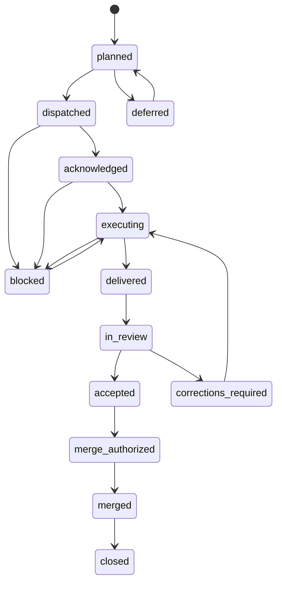

# Engineering task lifecycle — no fake completions

The Room lifecycle is a causal **evidence trail**; Cloudroom owns the authoritative Kanban status. The Room broker must not implement an independent shadow board.

## Allowed sequence

All transitions are appended as new events; no prior event is modified. Some work packages deliberately end at a review receipt without a merge (analysis-only packets); Cloudroom records that alternative close reason explicitly, not by falsely generating a merge event. The reference implementation models the standard PR-based engineering cycle.

## Gates

| Transition | Required evidence | Authority |
|---|---|---|
| Plan → Dispatch | Existing task, scope, dependency and base SHA | Cloudroom coordinator |
| Dispatch → ACK | Exact task/event, actual seat/instance, capacity | Assigned builder |
| Execute → Delivered | PR URL, full 40-char SHA, tests, blockers/limitations | Builder |
| Delivered → Review | Same immutable head and review brief | Cloudroom coordinator |
| Review → Accepted/Rejected | Independent reviewer, exact SHA, check reruns, written verdict | Vision / independent verifier |
| Accepted → Merge authorized | Founder instruction naming PR and reviewed SHA, or narrow prior authorization | Founder / explicitly delegated gate |
| Authorized → Merged | GitHub merge SHA, no drift, checks appropriate to scope | Gate executor |
| Merged → Closed | Cloudroom task marked Done with review + merge evidence | Cloudroom coordinator |
| Closed → Worktree retirement | Clean worktree, PR merged, no unfinished changes, task closure | Engineering floor |

## Founder decisions vs routine engineering

Mapping providers, public coordinate precision, new payment commitments, scope expansion, merge authorization and budget changes are product-level calls. Variable names, test structure, worktree paths and routine retry mechanics belong to the engineering coordinator. Don't ask the Founder to approve every PR comment, ACK, or filesystem action.

## No false success

An AG pane labelled `done`, a successful `git push`, a PR marked `mergeable`, a Cloudroom thread summary or a passing test on a local unpushed head is **not** Vision acceptance. An intentionally failing informational CI gate must remain visibly red and cannot masquerade as a passing acceptance assertion.

## Reference tests

`protocol/v2/taskLifecycle.mjs` and `tests/room-v2-lifecycle.test.mjs` express the normal PR-based sequence and reject builder=reviewer, SHA drift, missing merge authority and missing closure evidence. This is not automatically wired into current Cloudroom Kanban.
